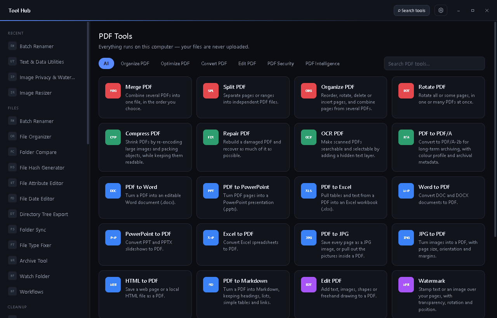
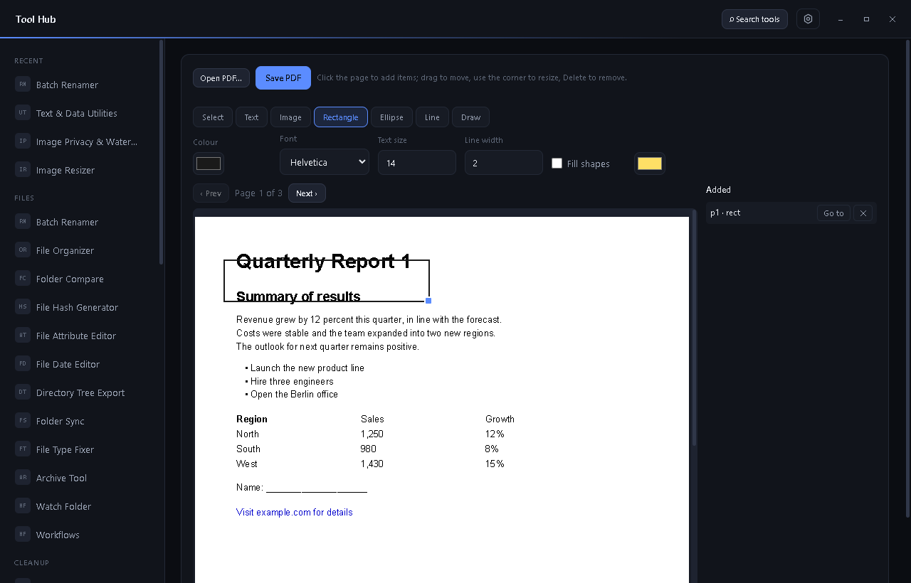
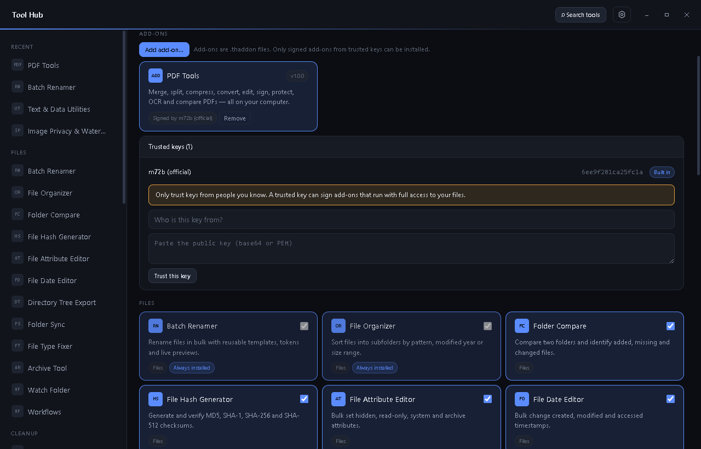

<div align="center">


<pre>
               /$$$$$$$$ /$$$$$$  /$$             /$$$$$$$$                  /$$         /$$                 /$$
              |_____ $$//$$__  $$| $$            |__  $$__/                 | $$        | $$                | $$
 /$$$$$$/$$$$      /$$/|__/  \ $$| $$$$$$$          | $$  /$$$$$$   /$$$$$$ | $$        | $$$$$$$  /$$   /$$| $$$$$$$
| $$_  $$_  $$    /$$/   /$$$$$$/| $$__  $$         | $$ /$$__  $$ /$$__  $$| $$ /$$$$$$| $$__  $$| $$  | $$| $$__  $$
| $$ \ $$ \ $$   /$$/   /$$____/ | $$  \ $$         | $$| $$  \ $$| $$  \ $$| $$|______/| $$  \ $$| $$  | $$| $$  \ $$
| $$ | $$ | $$  /$$/   | $$      | $$  | $$         | $$| $$  | $$| $$  | $$| $$        | $$  | $$| $$  | $$| $$  | $$
| $$ | $$ | $$ /$$/    | $$$$$$$$| $$$$$$$/         | $$|  $$$$$$/|  $$$$$$/| $$        | $$  | $$|  $$$$$$/| $$$$$$$/
|__/ |__/ |__/|__/     |________/|_______/          |__/ \______/  \______/ |__/        |__/  |__/ \______/ |_______/
</pre>

# Tool Hub

**A modular desktop toolbox for files, cleanup, system maintenance, media, PDFs, screenshots, fonts and your clipboard.**
Pick only the tools you need. Everything runs locally on your computer.

[](https://github.com/m72b/Tool-Hub/releases)
[](LICENSE)
[](#installation)
[](https://www.electronjs.org/)

[**Download**](https://github.com/m72b/Tool-Hub/releases) ·
[Features](#features) ·
[Add-ons](#add-ons) ·
[Development](#development) ·
[Security](#security) ·
[Report a bug](https://github.com/m72b/Tool-Hub/issues)



</div>

---

## Contents

- [Features](#features)
- [Installation](#installation)
- [Add-ons](#add-ons)
- [Screenshots](#screenshots)
- [Development](#development)
- [Project structure](#project-structure)
- [Security](#security)
- [License](#license)

## Features

- **Download only what you need.** Every section is a small add-on you can add or remove on its own, and you can hide single tools too.
- **Private by design.** Files, screenshots and clipboard history stay on your computer and are never uploaded.
- **Safe changes.** Deletions go to the Recycle Bin, renames and moves can be undone from the Activity Log, and file tools only write inside the folder you picked.
- **Signed and safe.** Every section is a [signed add-on](#add-ons), checked before it is installed. Tool Hub works fully offline.
- **Yours to style.** Six themes, three corner styles, favourites, a command palette (<kbd>Ctrl</kbd>+<kbd>K</kbd>), and drag-and-drop folders.

### Sections

Tool Hub comes with the Starter Tools. Everything else is a section you add from the Tool Library: File Tools, Cleanup Tools, System Tools, Media Tools, PDF Tools, Clipboard Manager, Screenshot & Capture, Font Manager, Event Log Analyzer and Device Manager.

📦 **[See every add-on and its tools](docs/SECTIONS.md)**

## Installation

1. Download the latest installer from the [**Releases**](https://github.com/m72b/Tool-Hub/releases) page (`tool-hub-Setup-<version>.exe` on Windows).
2. Run it, and choose whether to install for your account only or for everyone on the PC.
3. Download `tool-hub-addons-<version>.zip` from the same page and unzip it. It holds every section as a `.thaddon` file.
4. In Tool Hub, open **Settings → Open Tool Library**, click **Add add-on…** and choose the sections you want.

Tool Hub also has a **portable mode** that keeps its settings next to the app. Turn it on from the Settings panel.

**Upgrading from version 4?** The tools that used to be built in are now sections. Add the ones you use from the add-ons zip, and your settings carry over.

## Add-ons

Every section is a signed `.thaddon` add-on. Open **Settings → Open Tool Library** to manage them:

- **Remove** a section to delete its tools from your computer, along with any history it kept. Tool Hub restarts without them.
- **Add add-on…** installs a `.thaddon` file from the add-ons zip on the [Releases](https://github.com/m72b/Tool-Hub/releases) page. Adding a newer file updates that section.

Each add-on's Ed25519 signature and the hash of every file inside it are checked before it is installed. Opening the Tool Library still checks GitHub for a published add-on list, unless **Never connect to the internet** is on. That is the only time Tool Hub goes online. Add-ons from other authors must be [checked and authorized by an admin](docs/ADDONS.md#third-party-add-ons) before they are published, and show **"Authorized by …"** when installed.

📘 **[Add-on guide](docs/ADDONS.md)** covers installing, building and signing releases, and [writing your own add-on](docs/ADDONS.md#making-your-own-personal-add-on).

## Screenshots

<table>
  <tr>
    <td width="50%"><p align="center"><sub>Edit PDF: add text, images, shapes and drawings</sub></p></td>
    <td width="50%"><p align="center"><sub>Tool Library: download, update and remove sections</sub></p></td>
  </tr>
</table>

## Development

**Requirements:** [Node.js](https://nodejs.org/) 20 or newer and npm.

```bash
git clone https://github.com/m72b/Tool-Hub.git
cd Tool-Hub
npm install
npm start          # run the app
npm test           # run all test suites
```

| Command | What it does |
|---|---|
| `npm start` | Start Tool Hub from source |
| `npm test` | Run every test suite |
| `npm run addons` | Build and sign every section, plus the signed catalog, into `dist/addons/` |
| `npm run build-win` · `build-mac` · `build-linux` | Build all sections and an installer into `dist/` |
| `npm run addon:build -- addons/<section>` | Build and sign one section |
| `npm run icon` | Regenerate the app icon |
| `npm run addon:keygen` | Create an add-on signing key |
| `npm run toolhub -- <command>` | Command-line tools: `hash`, `tree`, `duplicates`, `file-types` |

## Project structure

```
main.js                  Electron main process: window, IPC, file-access approval
preload.js               Safe bridge exposed to the window as window.hub
cli.js                   Command-line entry point
src/
  core/                  Tool registry, install state, host, add-on system, signed catalog, safety helpers
  renderer/              App shell, design system and Sections screen
addons/                  One folder per section: main/ (tool code) and renderer/ (screens)
scripts/                 Add-on, catalog and icon build scripts
docs/                    Add-on guide and screenshots
test/                    Test suites for every layer
```

Every tool call goes through one checked channel. Before anything runs, the host confirms that the tool exists, runs on this platform and is installed, and that the requested action exists:

```
window → hub.invoke(tool, action, params) → main process → host → tool module
```

## Security

- **No shell injection.** Commands run through `execFile` with argument arrays. User paths reach PowerShell only through environment variables or temporary list files.
- **File access is opt-in.** File tools can only touch files and folders you picked in a dialog. Destructive actions re-check that the target is inside that folder, including symlink targets. Font Manager also reads the system font folders, and writes only to your user font folder.
- **Sensitive tools are off or limited by default.** Clipboard monitoring stays off until you start it. Screen capture only runs when you ask for it, and safe removal is the only Device Manager action that changes anything.
- **Recoverable by default.** Deletions use the Recycle Bin unless you explicitly choose permanent deletion.
- **Locked-down window.** Context isolation, sandboxing and a strict Content Security Policy are on, and navigation and pop-ups are blocked.
- **Signed add-ons.** Add-ons must carry a valid Ed25519 signature from a trusted key, and every file is hash-checked.

Found a security issue? Please [open an issue](https://github.com/m72b/Tool-Hub/issues) and mark it as security related.

## Acknowledgements

The PDF Tools add-on is built on [pdf-lib](https://github.com/Hopding/pdf-lib), [pdf.js](https://github.com/mozilla/pdf.js), [fontkit](https://github.com/Hopding/fontkit) and [qpdf](https://github.com/qpdf/qpdf). Audio tags are read with [music-metadata](https://github.com/Borewit/music-metadata). Third-party licenses are listed in [`addons/pdf-tools/licenses`](addons/pdf-tools/licenses/THIRD-PARTY.md).

## License

Released under the [MIT License](LICENSE). © 2026 m72b
